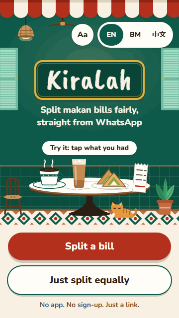
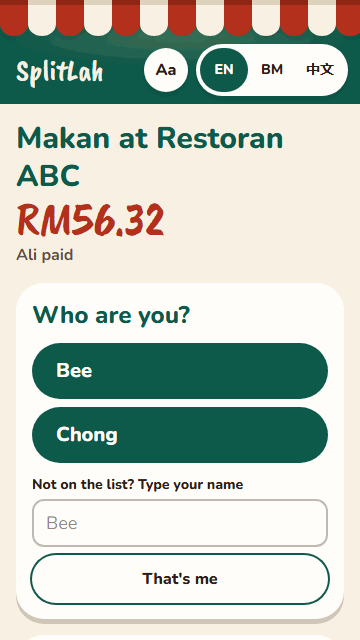
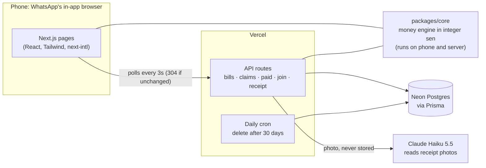

# KiraLah 🍛

**Split makan bills fairly, straight from WhatsApp.** No app, no sign-up, just a link.


| The payer, in under a minute                                                                            | A friend, in under 20 seconds                                                         |
| ------------------------------------------------------------------------------------------------------- | ------------------------------------------------------------------------------------- |
|  |  |

**Live:** not deployed yet. See [docs/LAUNCH.md](docs/LAUNCH.md).

## The problem

When friends eat out in Malaysia, one person pays and everyone pays them back. Working out who owes what is surprisingly fiddly:

- shared dishes, and dishes for one person
- 10% service charge, then 6% SST charged on top of it
- vouchers, member discounts, 1-for-1 promos, and whose voucher it was
- rounding, so the shares add up to exactly the receipt
- chasing people to pay

## What it does

1. **The payer** snaps the receipt (Claude reads it) or types the dishes, checks service charge and SST, adds friends' names and payment details, and shares one link to the WhatsApp group.
2. **Each friend** taps the link, taps their name, taps what they had, and sees "You pay Ali RM12.40" with a breakdown and the payer's DuitNow QR or account number. Then "I've paid ✅".
3. **The payer** watches who has picked and who has paid, live, and sends a reminder with each person's exact amount in one tap.

**Also:** "Just split equally" for when nobody wants to itemise, English, Bahasa Melayu and 简体中文 (switch in one tap), dark mode, large text, install to the home screen, and drafts that are never lost.

### Design principles

- **No download, no login.** Everything works from a link opened inside WhatsApp.
- **WhatsApp first.** Sharing, link previews and reminders are built for it.
- **One main action per screen**, big buttons, one-handed on a cheap Android phone and slow data.
- **Plain words.** "You pay Ali RM12.40", not accounting terms.
- **Never lose work.** Drafts autosave, and Back never deletes anything.

## Architecture



A pnpm monorepo: `apps/web` (Next.js App Router, TypeScript strict) and `packages/core` (pure TypeScript money logic, no UI). Zod validates every API input, every AI reply and every stored record.

## Money rules

All money is integer sen; no floating point anywhere. Shares of shares are kept as exact fractions and rounded once, at the end.

**Worked example.** Ali had Set A (RM35.90), Bee had Set B (RM29.90), and they shared fries (RM13.20), with a member 20% discount, 10% service charge and 6% SST:

| Step                          | Amount      |
| ----------------------------- | ----------- |
| Subtotal                      | RM79.00     |
| Member 20% off                | −RM15.80    |
| Service charge 10% of RM63.20 | RM6.32      |
| SST 6% of RM69.52             | RM4.17      |
| **Total**                     | **RM73.69** |

Ali ordered RM42.50 of the RM79.00, so owes exactly RM39.6433…; Bee owes RM34.0467…. Rounded down, that leaves 1 sen, which goes to the bigger fraction: **Ali RM39.64, Bee RM34.05**, adding up to exactly RM73.69.

Calculation order, "whose voucher", minimum spend, cash rounding and the two honest exceptions to "removing a discount never lowers anyone's share" are all in [docs/DECISIONS.md](docs/DECISIONS.md#money-rules).

## Testing

| Layer                          | What                                                                                                                                                           | Count                                             |
| ------------------------------ | -------------------------------------------------------------------------------------------------------------------------------------------------------------- | ------------------------------------------------- |
| Unit                           | Money engine, parsing, drafts, receipt conversion, permissions helpers                                                                                         | 172 tests                                         |
| Worked examples                | Bills modelled on Malaysian receipts, answers calculated by hand                                                                                               | 17                                                |
| Property-based (fast-check)    | Shares always add up exactly; never negative; no items means RM0; cash rounding gives multiples of 5 sen; and more                                             | 1,000 random bills each                           |
| End-to-end (Playwright, 360px) | Payer creates → friend on a second phone picks and pays → payer sees ✅; permissions; offline; dark mode; large text; axe accessibility checks on every screen | 39 tests                                          |
| Receipt reading eval           | Dishes found, prices, charges and total, against hand-checked answers                                                                                          | 6 synthetic receipts; not yet run against the API |

```bash
pnpm lint && pnpm typecheck && pnpm test
pnpm test:e2e
pnpm eval   # needs ANTHROPIC_API_KEY; a few cents
```

## Design decisions

The reasoning for each is in [docs/DECISIONS.md](docs/DECISIONS.md).

- **Integer sen, exact fractions, rounding once.** Floats drift, and a share of a share of a share isn't whole sen.
- **Largest-remainder rounding.** Shares always add up to the receipt. The payer takes the extra sen in a tie, so nobody chases a friend for 1 sen.
- **Configurable calculation order.** Covers vouchers before or after charges, SST on the service charge or not, and nett prices, because Malaysian receipts differ.
- **No-login security.** Unguessable 16-character links, a secret edit token on the payer's phone, and a token on each friend's phone after they pick their name. Only hashes are stored, and every permission is checked on the server.
- **Polling, not WebSockets.** Works on free hosting and survives WhatsApp's browser being paused. Unchanged bills answer `304` with no body.
- **Privacy.** Only first names, dishes and prices are stored. Receipt photos are never stored. Bills are deleted after 30 days. Stats are counts only.

## Usability testing

Not done yet. It will be run with 3 friends who haven't seen the app, timing the 20-second friend and 60-second payer targets, using [docs/USABILITY.md](docs/USABILITY.md). Findings and what changed will go here.

## Usage

Not launched yet. `/stats` shows bills split, people per bill and ringgit split, as counts only. Real numbers will go here after launch.

## Roadmap and known limitations

- **Real-world proof still to come:** testing on real phones in WhatsApp, Lighthouse on the deployed site, and the receipt eval on real receipts.
- **Uneven shares of a dish** ("Ali had 2 of the 3 teh tarik") work in the money engine, but the screens only split a shared dish equally.
- **1-for-1 works within one dish line.** For two different dishes, use RM off on the free one.
- **Losing the phone means losing edit access** to bills made on it, because there are no accounts.
- **Up to 3 seconds** before another phone sees a change.

## Run it locally

Needs Node 24+ and pnpm (`corepack enable`).

```bash
pnpm install
cp .env.example apps/web/.env
docker compose up -d
pnpm db:deploy
pnpm dev
```

Deploying: [docs/LAUNCH.md](docs/LAUNCH.md).

## Licence

[MIT](LICENSE)
